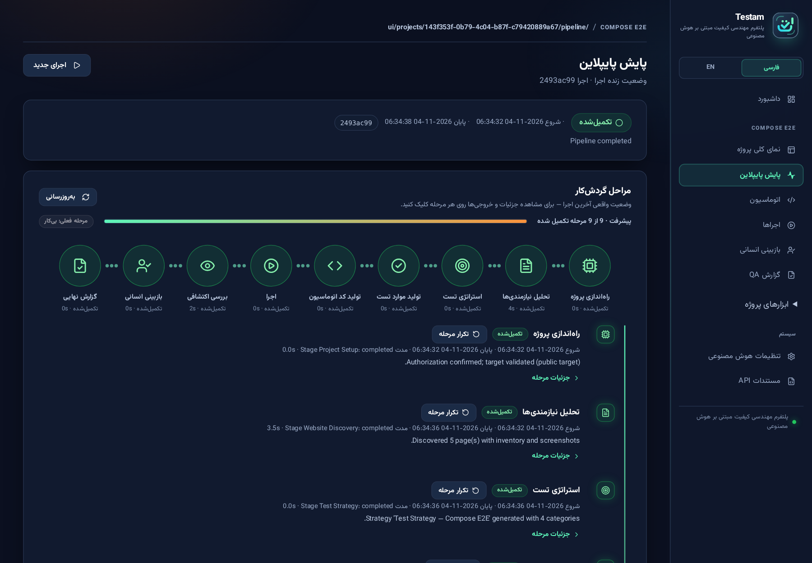
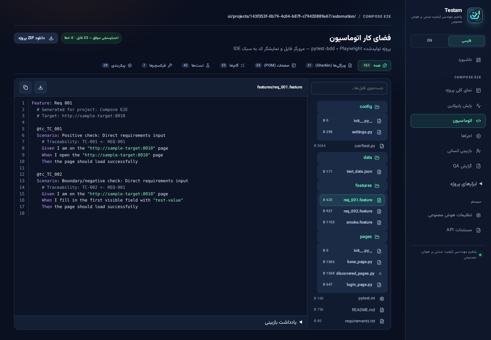
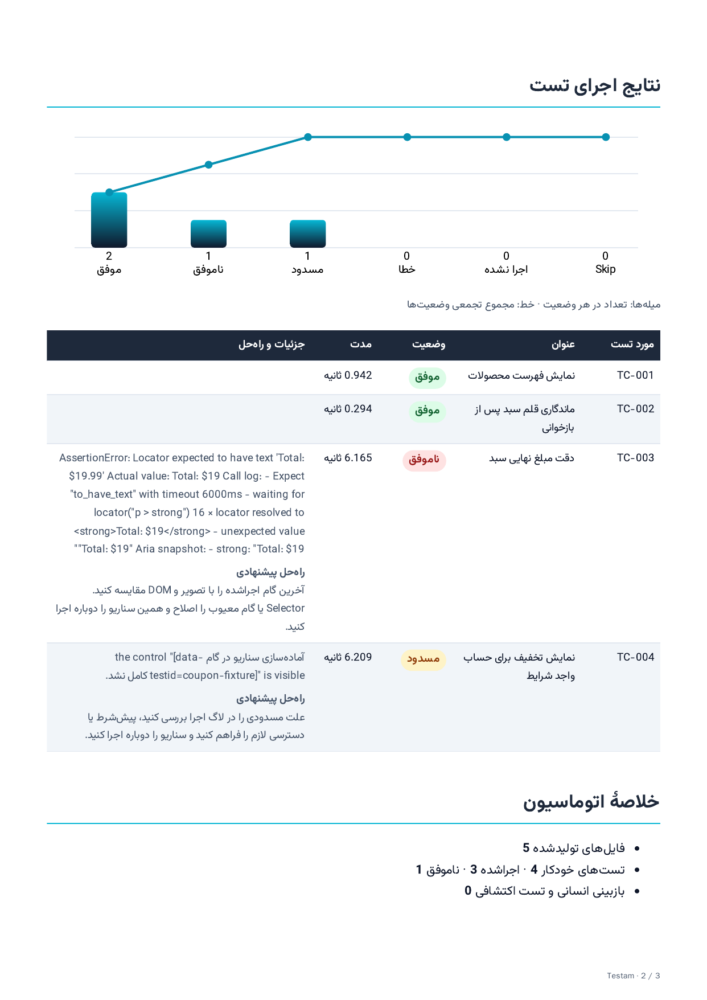

# Testam

Testam is an AI-assisted QA harness for authorized web applications. It connects product requirements to reviewable test cases, generated automation, and execution evidence.

## Workflow

1. Provide requirements, a target URL, and the test-environment context.
2. Review the discovered pages, requirements analysis, test strategy, and traceable test cases.
3. Inspect the generated Playwright and pytest-bdd code in the automation workspace.
4. Approve the package before the isolated Runner starts. If the package needs changes, record the reason and repeat the relevant stages.
5. Review the results, including the evidence and suggested next action for failures and blockers.

## A storefront example

The demo run produced two passes, one failure, and one blocked case. The total displayed as **$19** for an item priced at **$19.99**. A separate discount scenario was blocked because its setup data was unavailable.

| Automation workspace | Execution report |
| --- | --- |
|  |  |

See [the sample Gherkin scenario](cart-persistence.feature) for a requirement-linked check of cart persistence after reload. The scenario is a reference for the generated format.

## What is included

This showcase contains public documentation, demo screenshots, and one representative scenario. The Testam application and runner implementation are maintained privately.
